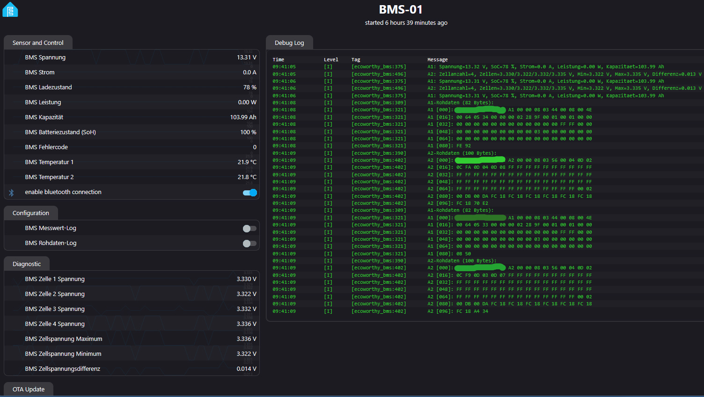

# ESPHome Eco-Worthy BLE

Eine externe ESPHome-Komponente zur Überwachung von ECO-WORTHY-LiFePO4-Batterien 
über Bluetooth Low Energy (BLE).

Dieses Projekt implementiert das native ECO-WORTHY-BLE-Protokoll in C++ für ESPHome.  
Es verwendet **nicht das JBD-Protokoll**.

## Vorschau
Weboberfläche der ESPHome Eco-Worthy BLE-Komponente


## Funktionen

* Native BLE-Kommunikation mit ECO-WORTHY-BMS
* ESPHome-Komponente in C++
* Batteriespannung, Strom, Leistung und Ladezustand (SoC)
* Batteriezustand (SoH) und Fehlercode
* Einzelne Zellspannungen
* Minimale und maximale Zellspannung
* Differenz zwischen minimaler und maximaler Zellspannung
* Temperaturmesswerte
* Konfigurierbares Aktualisierungsintervall
* Optionales Logging dekodierter Messwerte und roher BLE-Pakete
* Integration in den ESPHome-Webserver

## Recherche und Quellen

Das BLE-Protokoll des verwendeten ECO-WORTHY-BMS ist vom Hersteller nicht offiziell dokumentiert.  
Die Entwicklung dieser Komponente basiert auf öffentlich zugänglichen Community-Projekten,  
eigenen Aufzeichnungen der BLE-Kommunikation und experimenteller Analyse der übertragenen  
Datenpakete.

Folgende Projekte wurden im Rahmen der Recherche und Entwicklung herangezogen:

* [patman15/aiobmsble](https://github.com/patman15/aiobmsble)

  Python-Bibliothek zur Kommunikation mit verschiedenen Batterie-Management-Systemen über 
  Bluetooth Low Energy. Die ECO-WORTHY-Implementierung diente als Referenz für die Untersuchung 
  des herstellerspezifischen BLE-Protokolls und der übertragenen Messdaten.

* [ericbarch/ecoworthy-bms-exporter](https://github.com/ericbarch/ecoworthy-bms-exporter)

  Community-Projekt zur Überwachung von ECO-WORTHY-Batterien über BLE. 
  Es diente als zusätzliche Referenz für die Untersuchung der Kommunikation, 
  der Datenpakete und ihrer Interpretation.

* [kbennett2000/linux-lifepo4-bms-monitor](https://github.com/kbennett2000/linux-lifepo4-bms-monitor)

  Linux-basierte Batterieüberwachung mit Unterstützung verschiedener BMS-Protokolle, 
  einschließlich ECO-WORTHY. Das Projekt wurde als weitere Referenz im Rahmen der 
  Protokollrecherche berücksichtigt.

* [syssi/esphome-jbd-bms](https://github.com/syssi/esphome-jbd-bms)

  ESPHome-Komponente zur Überwachung von JBD-Batterie-Management-Systemen über UART oder BLE. 
  Das Repository diente als Referenz für die ESPHome-Integration und die Kommunikation über BLE. 
  Das darin implementierte JBD-Protokoll ist nicht das von dieser Komponente verwendete 
  ECO-WORTHY-Protokoll.

### Eigenständige Implementierung

Auf Grundlage der Recherche, eigener BLE-Aufzeichnungen und experimenteller Auswertung 
wurde eine eigenständige ESPHome-Komponente in C++ entwickelt.

Die Implementierung verwendet das native ECO-WORTHY-BLE-Protokoll und ist keine Portierung 
der JBD-Protokollimplementierung. Sie verarbeitet die identifizierten 
Antwortpakete `A1` und `A2`, dekodiert die unterstützten Messwerte und stellt diese 
als ESPHome-Sensoren bereit.

Die genannten Projekte werden als technische Referenzen aufgeführt. Daraus folgt nicht, 
dass Quellcode aus jedem dieser Projekte übernommen wurde.

Die dokumentierten Bytepositionen beziehen sich auf die vollständig aufgezeichneten BLE-Pakete. 
Diese enthalten am Anfang sechs Bytes mit der Bluetooth-Adresse.

## Getestetes Gerät

Die bisherige Entwicklung und Erprobung erfolgte mit folgendem Gerät:

| Eigenschaft               | Wert                 |
| ------------------------- | -------------------- |
| Bluetooth-Gerätename      | `ECO-WORTHY 0B_ED28` |
| BMS-Modellkennung         | `L13080202134-1`     |
| BLE-Service-UUID          | `FFF0`               |
| BLE-Notify-Characteristic | `FFF1`               |
| BLE-Write-Characteristic  | `FFF2`               |
| Länge des A1-Pakets       | 82 Bytes             |
| Länge des A2-Pakets       | 100 Bytes            |

Die Kompatibilität mit anderen ECO-WORTHY-Modellen und Firmwareversionen wurde bisher 
nicht bestätigt.

## Aufbau der BLE-Pakete

Bisher wurden zwei Antwortpakettypen identifiziert:

| Paket |     Länge | Inhalt                                               |
| ----- | --------: | ---------------------------------------------------- |
| `A1`  |  82 Bytes | Allgemeine Batteriemesswerte und Statusinformationen |
| `A2`  | 100 Bytes | Zellspannungen und Temperaturmesswerte               |

Die ersten sechs Bytes enthalten die Bluetooth-Adresse. 
Die Kennung des Pakettyps (`A1` oder `A2`) befindet sich an Byteposition 6.

**Wichtig:** Alle Bytepositionen in den folgenden Tabellen beginnen bei `0` und beziehen 
sich auf das vollständige Paket, einschließlich der sechs Bytes mit der Bluetooth-Adresse.

Die Byte-Reihenfolge und Skalierung der dokumentierten Messwerte basieren auf der 
bisherigen Protokollanalyse und den aufgezeichneten BLE-Daten. 
Big-Endian ist für die entsprechend ausgewerteten Felder dokumentiert. 
Für noch nicht unabhängig überprüfte Datenfelder kann eine abweichende Byte-Reihenfolge 
nicht ausgeschlossen werden.


## A1 – Batteriedaten

Das `A1`-Paket enthält allgemeine Batteriemesswerte und Statusinformationen. 
Die Zuordnung und Umrechnung der dokumentierten Felder basieren auf der bisherigen 
Protokollanalyse. Soweit einzelne Felder aus Community-Referenzen übernommen und noch 
nicht unabhängig verifiziert wurden, ist ihre Zuordnung als vorläufig zu betrachten.


| Byteposition | Anzahl Bytes | Bezeichnung           | Umrechnung                        | Einheit | Nachkommastellen |
| ------------ | -----------: | --------------------- | --------------------------------- | ------- | ---------------: |
| `15`         |            1 | Ladezustand (SoC)     | Rohwert                           | %       |                0 |
| `16–17`      |            2 | Batteriezustand (SoH) | Rohwert, Big-Endian               | %       |                0 |
| `18–19`      |            2 | Batteriespannung      | Rohwert / 100                     | V       |                2 |
| `20–21`      |            2 | Batteriestrom         | Vorzeichenbehafteter Rohwert / 10 | A       |                1 |
| `24–25`      |            2 | Kapazität             | Rohwert / 100                     | Ah      |                2 |
| `49–50`      |            2 | Fehlercode            | Rohwert, Big-Endian               | –       |                0 |

### Berechnete Werte

Die folgenden Werte werden von der Komponente berechnet und nicht direkt aus einem einzelnen 
Datenfeld gelesen.

| Bezeichnung            | Berechnung                                    | Einheit |
| ---------------------- | --------------------------------------------- | ------- |
| Batterieleistung       | Batteriespannung × Batteriestrom              | W       |
| Minimale Zellspannung  | Kleinster dekodierter Zellspannungswert       | V       |
| Maximale Zellspannung  | Größter dekodierter Zellspannungswert         | V       |
| Zellspannungsdifferenz | Maximale Zellspannung − minimale Zellspannung | V       |

Das Vorzeichen des Stroms hängt von der vom BMS gemeldeten Stromrichtung ab.

## A2 – Zell- und Temperaturdaten

Das `A2`-Paket enthält die einzelnen Zellspannungen und Temperaturmesswerte.

### Zellspannungen

| Byteposition | Anzahl Bytes | Bezeichnung                                 | Umrechnung     | Einheit | Nachkommastellen |
| ------------ | -----------: | ------------------------------------------- | -------------- | ------- | ---------------: |
| `13`         |            1 | Zellanzahl laut bisheriger Parserauswertung | Rohwert        | Zellen  |                0 |
| `14–15`      |            2 | Zellspannung 1                              | Rohwert / 1000 | V       |                3 |
| `16–17`      |            2 | Zellspannung 2                              | Rohwert / 1000 | V       |                3 |
| `18–19`      |            2 | Zellspannung 3                              | Rohwert / 1000 | V       |                3 |
| `20–21`      |            2 | Zellspannung 4                              | Rohwert / 1000 | V       |                3 |

Die aufgezeichneten Rohdaten enthalten an den Positionen `12–13` die Bytes `00 04`. 
Der Wert `04` an Position `13` entspricht der beobachteten Zellanzahl von vier Zellen.

Die genaue Feldbreite und Zuordnung ist anhand der Protokollimplementierung zu überprüfen.


### Temperaturmesswerte

| Byteposition | Anzahl Bytes | Bezeichnung                   | Umrechnung          | Einheit  | Nachkommastellen |
| ------------ | -----------: | ----------------------------- | ------------------- | -------- | ---------------: |
| `78–79`      |            2 | Anzahl der Temperatursensoren | Rohwert, Big-Endian | Sensoren |                0 |
| `80–81`      |            2 | Temperatur 1                  | Rohwert / 10        | °C       |                1 |
| `82–83`      |            2 | Temperatur 2                  | Rohwert / 10        | °C       |                1 |

Die aufgezeichneten Temperaturwerte wurden anhand praktischer Messungen mit dem getesteten 
BMS überprüft und sind plausibel. Die Anzahl der gemeldeten Temperatursensoren und die Zuordnung 
der Temperaturfelder beziehen sich auf die untersuchte Paketstruktur. 
Eine allgemeine Gültigkeit für andere ECO-WORTHY-Modelle ist damit nicht bestätigt.


## Beispiele aus aufgezeichneten Rohdaten

Die folgenden Werte stammen aus aufgezeichneten Paketen des getesteten BMS.

### A1 – Beispielwerte

| Bezeichnung      | Rohdaten | Dekodierter Wert |
| ---------------- | -------- | ---------------: |
| Ladezustand      | `4F`     |             79 % |
| Batteriezustand  | `00 64`  |            100 % |
| Batteriespannung | `05 33`  |          13,31 V |
| Batteriestrom    | `00 00`  |            0,0 A |
| Kapazität        | `28 9F`  |        103,99 Ah |
| Fehlercode       | `00 00`  |                0 |

### A2 – Beispielwerte

| Bezeichnung               | Rohdaten            | Dekodierter Wert |
| ------------------------- | ------------------- | ---------------: |
| Zellanzahl                | `04` an Position 13 |                4 |
| Zellspannung 1            | `0D 02`             |          3,330 V |
| Zellspannung 2            | `0C FA`             |          3,322 V |
| Zellspannung 3            | `0D 04`             |          3,332 V |
| Zellspannung 4            | `0D 07`             |          3,335 V |
| Anzahl Temperatursensoren | `00 02`             |                2 |
| Temperatur 1              | `00 E6`             |          23,0 °C |
| Temperatur 2              | `00 E2`             |          22,6 °C |

Diese Tabelle dokumentiert eine konkrete Aufzeichnung. Sie garantiert nicht, dass alle ECO-WORTHY-Modelle dieselbe Datenstruktur oder Skalierung verwenden.

## Beispielkonfiguration

Das folgende Beispiel zeigt die Konfiguration, die mit der für dieses Projekt verwendeten 
ESPHome-Version getestet wurde.

**Voraussetzungen:**

* ESPHome in der verwendeten Version `2026.5.3` oder einer kompatiblen Version.
* ESPHome-Webserver V3 (`web_server: version: 3`).

Die Konfiguration verwendet ESPHome-Funktionen und Syntax, deren Verfügbarkeit von der 
ESPHome-Version abhängen kann. Bei älteren Versionen können Anpassungen erforderlich sein.

WLAN-Zugangsdaten und Bluetooth-Adresse müssen an die eigene Installation angepasst werden.


```yaml
esphome:
  name: bms01
  friendly_name: BMS-01

esp32:
  board: "esp32-s3-devkitc-1"
  variant: "esp32s3"
  framework:
    type: esp-idf

external_components:
  - source:
      type: local
      path: ./components

wifi:
  ssid: "WIFI-SSID"
  password: "SecretWifiPwd"
  reboot_timeout: 0s
  min_auth_mode: WPA2
  fast_connect: True
  on_connect:
    - logger.log:
        level: INFO
        format: "Connected to WiFi. Starting BLE scan."
  on_disconnect:
    - logger.log:
        level: INFO
        format: "Disconnected from WiFi. Stopping BLE scan."

web_server:
  port: 80
  version: 3

ota:
  platform: web_server
  on_begin:
    then:
      - switch.turn_off: ble_client_switch0
      - logger.log: "BLE connection suspended for OTA update"

logger:
  level: INFO

time:
  - platform: sntp
    id: sntp_time
    timezone: "Europe/Berlin"
    servers:
     - 127.0.0.1

# api:
esp32_ble_tracker:
  scan_parameters:
    active: false

ble_client:
  - id: client0
    mac_address: "00:00:00:00:00:00"
    on_connect:
      then:
        - logger.log:
            level: INFO
            format: "Connected to BMS device 0"
    on_disconnect:
      then:
        - logger.log:
            level: INFO
            format: "Disconnected from BMS device 0"

ecoworthy_bms:
  - id: bms0
    ble_client_id: client0
    update_interval: 2s

    voltage:
      name: "BMS Spannung"
      web_server:
        sorting_weight: 0

    current:
      name: "BMS Strom"
      web_server:
        sorting_weight: 1

    soc:
      name: "BMS Ladezustand"
      web_server:
        sorting_weight: 2
    power:
      name: "BMS Leistung"
      web_server:
        sorting_weight: 3
    capacity:
      name: "BMS Kapazität"
      web_server:
        sorting_weight: 4

    battery_health:
      name: "BMS Batteriezustand (SoH)"
      web_server:
        sorting_weight: 5
    problem_code:
      name: "BMS Fehlercode"
      web_server:
        sorting_weight: 6

    temperature1:
      name: "BMS Temperatur 1"
    temperature2:
      name: "BMS Temperatur 2"

    cell1_voltage:
      name: "BMS Zelle 1 Spannung"
      entity_category: diagnostic
    cell2_voltage:
      name: "BMS Zelle 2 Spannung"
      entity_category: diagnostic
    cell3_voltage:
      name: "BMS Zelle 3 Spannung"
      entity_category: diagnostic
    cell4_voltage:
      name: "BMS Zelle 4 Spannung"
      entity_category: diagnostic

    cell_min_voltage:
      name: "BMS Zellspannung Minimum"
      entity_category: diagnostic
    cell_max_voltage:
      name: "BMS Zellspannung Maximum"
      entity_category: diagnostic
    cell_voltage_diff:
      name: "BMS Zellspannungsdifferenz"
      entity_category: diagnostic

switch:
  - platform: ble_client
    ble_client_id: client0
    name: "Enable bluetooth connection"
    id: ble_client_switch0

  - platform: template
    name: "BMS Messwert-Log"
    id: bms_log_values_switch
    optimistic: true
    restore_mode: ALWAYS_OFF
    entity_category: config
    web_server:
      sorting_weight: 0
    turn_on_action:
      - lambda: |-
          id(bms0)->show_log_values_ = true;
    turn_off_action:
      - lambda: |-
          id(bms0)->show_log_values_ = false;

  - platform: template
    name: "BMS Rohdaten-Log"
    id: bms_log_raw_data_switch
    optimistic: true
    restore_mode: ALWAYS_OFF
    entity_category: config
    web_server:
      sorting_weight: 1
    turn_on_action:
      - lambda: |-
          id(bms0)->show_log_raw_data_ = true;
    turn_off_action:
      - lambda: |-
          id(bms0)->show_log_raw_data_ = false;
```

## Logging

Die Komponente stellt zwei separate Schalter für die Protokollierung bereit:

* **BMS Messwert-Log:** Gibt dekodierte Messwerte aus.
* **BMS Rohdaten-Log:** Gibt die vollständigen `A1`- und `A2`-Pakete im Hexadezimalformat aus.

Das Rohdaten-Logging unterstützt die Untersuchung bisher unbekannter Datenfelder, den Vergleich unterschiedlicher Firmwareversionen und die Überprüfung von Bytepositionen.

## Einschränkungen

* Bisher wurde nur ein ECO-WORTHY-BMS-Modell (100Ah 12V) getestet.
* Das Protokoll ist vom Hersteller nicht offiziell dokumentiert.
* Andere Modelle und Firmwareversionen können abweichende Datenstrukturen und Skalierungen verwenden.
* Es werden nur die aktuell implementierten Datenfelder als Sensoren bereitgestellt.
* Die Komponente dient der Überwachung und ist kein Ersatz für die integrierten Schutzfunktionen des BMS.

## KI-Unterstützung

Die Entwicklung dieser Komponente erfolgte unter Zuhilfenahme künstlicher Intelligenz (KI).

Die KI unterstützte insbesondere bei der Analyse und Interpretation der recherchierten 
Protokollinformationen, der Entwicklung und Überarbeitung des C++-Codes, 
der Integration in ESPHome sowie bei der Fehlersuche.

Die Implementierung wurde anhand aufgezeichneter BLE-Daten und praktischer Tests 
mit dem angegebenen BMS überprüft. Die dokumentierten Ergebnisse beziehen sich auf das 
tatsächlich getestete Gerät und stellen keine allgemeine Kompatibilitätsgarantie 
für andere ECO-WORTHY-Modelle dar.


## Haftungsausschluss

Dieses Projekt ist ein unabhängiges, privat entwickeltes Open-Source-Projekt 
und steht in keiner Verbindung zu ECO-WORTHY.

Die Protokollinformationen dienen Forschungs- und Überwachungszwecken. 
Für den Schutz der Batterie vor Beschädigung, Überhitzung oder anderen 
gefährlichen Zuständen sind weiterhin die dafür vorgesehenen Schutzmechanismen zu verwenden.

